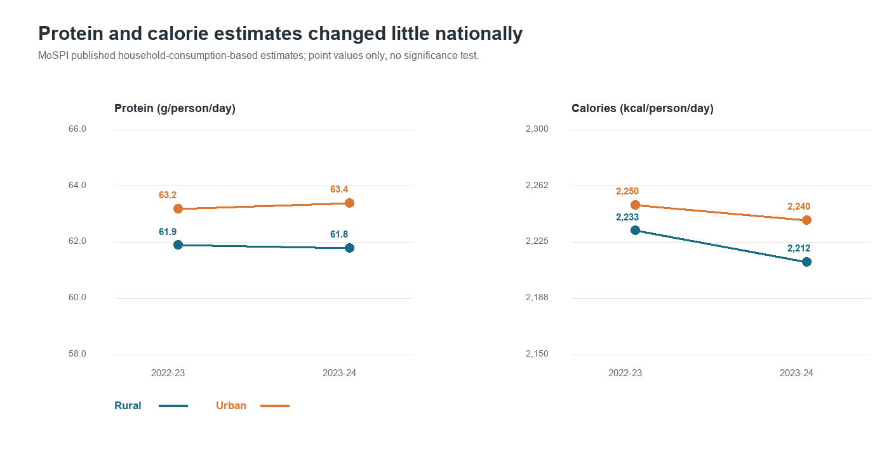
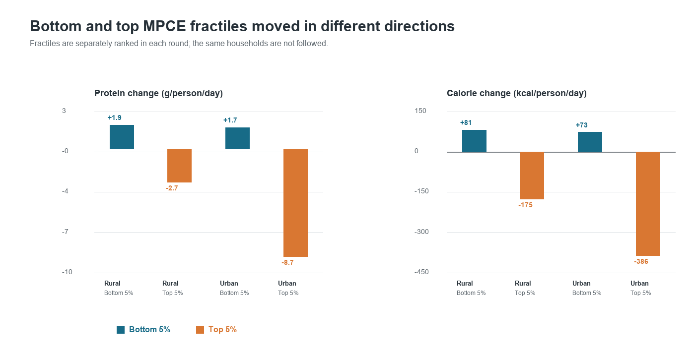
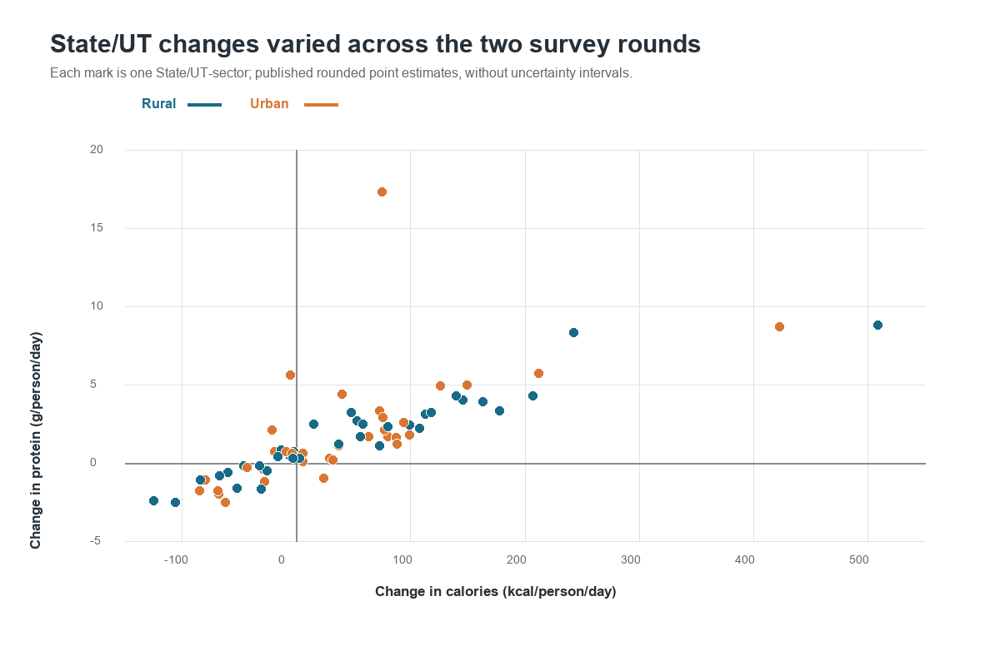
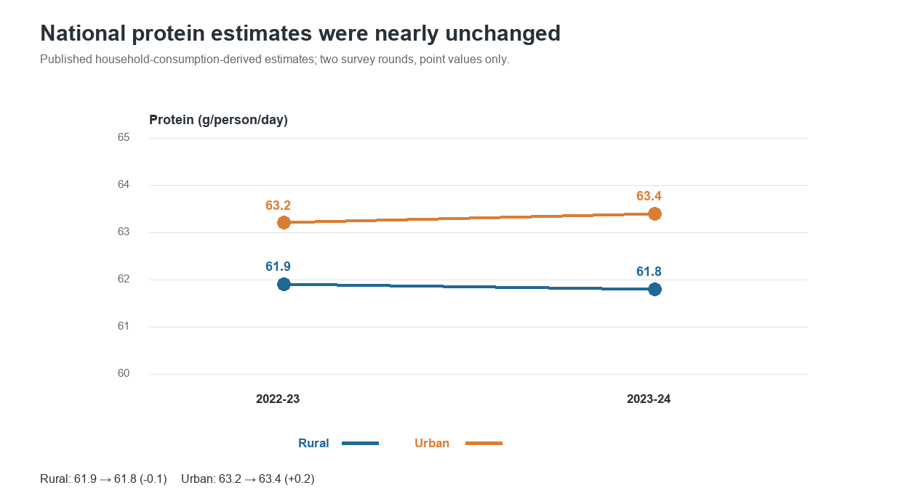
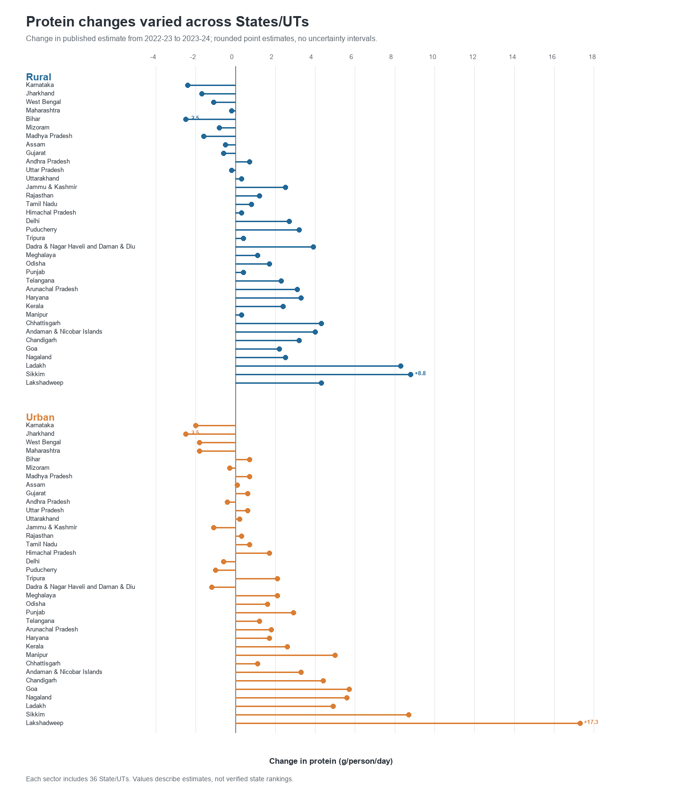
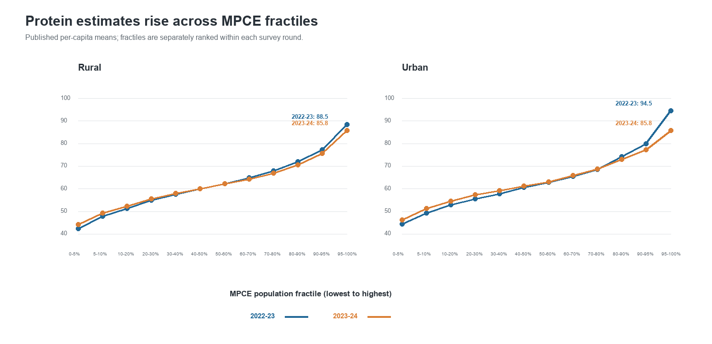
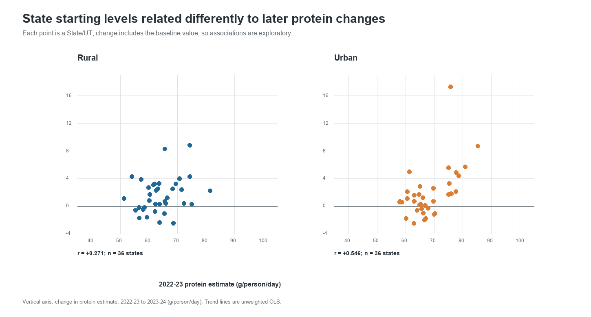

# Analyze trends in calorie, sugar, or protein intake using public datasets and statistical tools.

## Executive summary

This case study examines household-consumption-derived estimates of protein and calories in India using the National Sample Survey Office's Household Consumption Expenditure Survey (HCES) results for 2022-23 and 2023-24. Protein is the primary outcome; calories are the companion outcome. The central question is whether national averages conceal different patterns across residence, states, and expenditure groups.

National estimates were nearly stable between the two rounds. Rural protein changed from 61.9 to 61.8 g/person/day and urban protein from 63.2 to 63.4. Calories fell slightly: 2,233 to 2,212 kcal/person/day rural and 2,250 to 2,240 urban. Published MPCE-fractile estimates show a more contrasting pattern: the bottom 5% had higher protein and calorie estimates in 2023-24, while the top 5% had lower estimates. Thus the national mean masks meaningful descriptive differences across the distribution.

These are comparisons of rounded published aggregates from two repeated cross-sections. They do not show changes for the same households, do not establish causation or individual nutritional adequacy, and cannot be significance-tested with the uncertainty information assembled here. The unit-level nutrient reconstruction has not matched the published benchmarks closely enough for inferential analysis. The findings below are therefore descriptive and explicitly provisional as explanations.

## Research questions

1. How did protein and calories change between the latest comparable HCES rounds?
2. How do the patterns differ between rural and urban India, across States/UTs, and across MPCE population fractiles?
3. Do calorie and protein estimates move together?
4. Do the national means conceal distributional differences?
5. What can be concluded about sugar, dietary composition, adequacy, and causes of change?

## Data and methods

### Primary source and unit of analysis

The primary source is MoSPI/NSO, *NSS Report No. 594: Nutritional Intake in India (HCES 2022-23 and 2023-24)*. The report converts household food-consumption records to nutrient estimates using food nutrient values and publishes estimates by State/UT, rural/urban sector, and MPCE population fractile. The underlying construct is household food consumption converted to a per-capita nutrient estimate; it is not an individual dietary recall or measure of absorbed nutrients.

Two analysis-ready published-table datasets were assembled and checked against the report:

- State/sector panel: 148 rows, representing 37 State/UT and All-India labels × two sectors × two rounds.
- MPCE-fractile panel: 52 rows, representing 13 groups (12 fractiles plus All-India) × two sectors × two rounds.

Changes and percentages are calculated from the rounded displayed figures. The report tables available for this analysis do not provide standard errors or confidence intervals for these estimates, so the analysis reports point changes only. No p-values, significance labels, or causal models are used.

### Supporting data

An official monthly MoSPI food-and-beverages CPI series was compiled to support the separate microdata nutrient-conversion work. All 24 months used for the two survey-period averages are final. The resulting period averages are 179.3167 (combined) for August 2022–July 2023 and 192.8417 for August 2023–July 2024. CPI adjustment supports the conversion procedure; the CPI series is not itself a measure of food intake.

The project also contains household estimates for selected sugar commodities (sugar and jaggery-related questionnaire codes). Those estimates are exploratory only: the listed sugar codes exclude sugars contained in sweets, beverages, and other foods, and therefore are not total dietary sugar or total added sugar. They are not included in the primary findings.

### Analysis choices

- Use protein as the primary nutrient and calories as the companion outcome.
- Compare national rural and urban means, State/UT point changes, and published MPCE fractiles.
- Treat survey years as separate cross-sections; do not imply household-level change over time.
- Use the ratio of national mean protein to national mean calories only as a descriptive ratio of aggregate means, not as average person-level protein density.
- Do not infer nutritional adequacy, statistical significance, or causal effects.

## Results

### 1. National estimates were nearly unchanged

| Sector | Calories (kcal/person/day), 2022-23 → 2023-24 | Protein (g/person/day), 2022-23 → 2023-24 |
|---|---:|---:|
| Rural | 2,233 → 2,212 (-21; -0.9%) | 61.9 → 61.8 (-0.1; -0.2%) |
| Urban | 2,250 → 2,240 (-10; -0.4%) | 63.2 → 63.4 (+0.2; +0.3%) |

Over this adjacent-round comparison, calories edged down and protein was essentially flat. Two rounds do not establish a long-term trend.

### 2. Rural–urban gaps changed modestly and differently by nutrient

The urban-minus-rural calorie gap widened from 17 to 28 kcal/person/day. The protein gap widened from 1.3 to 1.6 g/person/day. The fat gap narrowed from 10.8 to 9.4 g/person/day: rural fat rose from 59.7 to 60.4 g/day while urban fat fell from 70.5 to 69.8. These are displayed point-estimate differences; without uncertainty estimates, whether the gaps truly changed is unknown.

The ratio of national mean protein to national mean calories rose from 27.72 to 27.94 g per 1,000 kcal in rural India and from 28.09 to 28.30 in urban India. This is a ratio of rounded aggregate means, not an average of household-level or person-level protein density.

### 3. State-level changes were heterogeneous

Among the 36 State/UT entries excluding All-India, calorie estimates fell in 15 rural and 15 urban comparisons; protein estimates fell in 10 rural and 10 urban comparisons. Both calories and protein fell in 10 rural comparisons and 9 urban comparisons.

The largest displayed calorie increases were in Sikkim (+509 rural and +423 urban kcal/day). The largest decreases were Karnataka rural (-125 kcal/day) and West Bengal urban (-85 kcal/day). These extrema should prompt source/context checks; the published point estimates alone do not establish outliers or reliable state rankings.

### 4. MPCE fractiles show a strong gradient and contrasting round-to-round changes

In both rounds and sectors, published mean protein and calories rise across MPCE population fractiles. Comparing the bottom and top 5%:

| Sector / fractile | Calories (kcal/person/day), 2022-23 → 2023-24 | Protein (g/person/day), 2022-23 → 2023-24 |
|---|---:|---:|
| Rural, bottom 5% | 1,607 → 1,688 (+81) | 42.4 → 44.3 (+1.9) |
| Rural, top 5% | 3,116 → 2,941 (-175) | 88.5 → 85.8 (-2.7) |
| Urban, bottom 5% | 1,623 → 1,696 (+73) | 44.5 → 46.2 (+1.7) |
| Urban, top 5% | 3,478 → 3,092 (-386) | 94.5 → 85.8 (-8.7) |

The top-to-bottom protein gap narrowed from 46.1 to 41.5 g/day rural and from 50.0 to 39.6 urban. The calorie gap narrowed from 1,509 to 1,253 kcal/day rural and from 1,855 to 1,396 urban. This descriptive compression reflects higher bottom-fractile and lower top-fractile estimates. The groups are ranked separately in each round, so this is not evidence that the same households changed intake.

### 5. Sugar is a secondary, incomplete measure

The separate unit-level calculation for selected sugar commodities estimates weighted all-India quantities of 22.27 g/person/day in 2022-23 and 21.73 g/person/day in 2023-24, a point decrease of about 0.54 g/day (2.4%). Rural estimates are 21.77 to 21.34 g/day; urban estimates 23.54 to 22.65 g/day. These values cover only selected sugar commodity codes, not sugar in all foods. They remain exploratory point estimates without design-based confidence intervals and are omitted from the primary conclusion.

### 6. Exploratory tests on the published aggregate tables

These tests use state/fractile point estimates as the analysis units. They are **not survey-design-adjusted population tests** and do not account for uncertainty in the underlying estimates.

An unweighted one-sample t-test across the 36 State/UT changes found positive average changes for both nutrients in rural and urban areas: calories +50.3 kcal/day rural (Holm-adjusted p=0.031) and +36.3 urban (p=0.031); protein +1.57 g/day rural (p=0.003) and +1.80 urban (p=0.016). This equal-weight state average differs from the national published change because each state is weighted equally in this calculation, rather than by population. It does not establish national increases.

The MPCE gradient is perfectly monotonic in all eight combinations of year, sector, and nutrient (Spearman rho=1.00). This formalizes the ordered pattern already visible in the published table; its group-level permutation p-value should not be interpreted as population-level significance.

State-level calorie and protein changes are positively associated (Pearson r=0.934 rural; r=0.622 urban). This is an ecological relationship between state point estimates, not a household-level relationship or causal effect. Full calculations and caveats are in `exploratory_aggregate_tests.md`.

## Answers and evidence strength

| Question | Current answer | Evidence status |
|---|---|---|
| Did national protein or calories rise? | Both were nearly stable; calories declined slightly, and protein was flat. | Descriptive, two rounds. |
| Does residence matter? | Rural and urban point estimates differ, with small changes in their gaps. | Descriptive; gap uncertainty unavailable. |
| Does higher MPCE rank coincide with higher nutrient estimates? | Yes, average protein and calories rise across published fractiles. | Descriptive association; not causal, and dietary composition is not established. |
| Do calories and protein move proportionally? | Not perfectly: urban calories edged down while protein edged up; rural both edged down. | Descriptive aggregate comparison. |
| Do averages hide differences? | Yes: bottom- and top-fractile estimates moved in opposite directions between rounds. | Descriptive; separate cross-sections. |
| Is total sugar intake falling? | Unknown. The available exploratory variable covers selected sugar commodities only. | Not answered for total/added sugar. |
| Are individuals nutritionally adequate? | Cannot be determined from these aggregate household-derived means. | Not answerable with current evidence. |
| Are the changes statistically significant or caused by economic change? | Not established. | Requires validated microdata, sampling-design variables, and further causal design for causation. |

## Main conclusion

The strongest supported conclusion is that national household-consumption-derived protein and calorie estimates changed very little between HCES 2022-23 and 2023-24, while published expenditure-fractile estimates show contrasting movements at the bottom and top of the distribution. This suggests that national averages alone provide an incomplete picture. The observed differences are descriptive signals, not proof of convergence, individual dietary improvement, or an effect of expenditure.

## Limitations and responsible interpretation

1. **Construct:** Household consumption converted to nutrients is not direct measurement of individual intake, absorption, or food allocation within a household.
2. **Time span:** Two adjacent rounds support a short comparison, not a robust long-run trend.
3. **Uncertainty:** Rounded aggregate point estimates without the required standard errors do not support significance tests or confidence intervals here.
4. **Repeated cross-sections:** Households are not followed across rounds; MPCE fractiles are independently ranked in each survey.
5. **Adequacy:** Mean grams per capita do not reveal the distribution of individual intake or whether requirements are met.
6. **Microdata validation:** The provisional unit-level reconstruction misses several published benchmarks and has unresolved mixed DDM/item-code handling. It is diagnostic only and is not used for the main estimates.
7. **Sugar coverage:** Selected commodity quantities omit sugar contained in other foods and should not be labeled total or added sugar intake.
8. **State extrema:** Large point changes need contextual and design-based checks before interpretation.

## Next research step

Exploratory tests on the published state and MPCE tables are recorded separately in `exploratory_aggregate_tests.md`. Their p-values describe aggregate-cell patterns and are not survey-design-adjusted population inference. The next optional extension is a bounded microdata validation: reconcile item codes and mixed DDM records, confirm weights and survey design variables, reproduce selected official estimates, and only then calculate design-aware uncertainty and conduct formal tests. The reconstruction currently does not pass validation, so no additional inferential claims should be made until that is resolved. A separate food-group composition analysis could follow if it can be harmonized consistently; sugar is not a blocker.

## Reproducibility files

- `analysis_ready_nutrition_state_sector.csv`
- `nutrition_changes_by_state_sector.csv`
- `mpce_fractile_nutrition.csv`
- `mpce_fractile_nutrition_changes.csv`
- `published_aggregate_analysis_report.md`
- `research_questions_synthesis.md`
- `provisional_microdata_nutrient_validation.md`
- `exploratory_aggregate_tests.md`
- `exploratory_aggregate_test_results.csv`
- `presentation_and_defense_guide.md`
- `cpi_food_beverages_validation.md`
- `plot_published_aggregate_findings.py`
- `plot_protein_four_analyses.py`
- `run_exploratory_aggregate_tests.py`

## Figures

## Supplemental protein analyses

The following section adds the four requested protein analyses and figures. It supplements the existing case study; earlier results and sections above are retained. The limitation above refers to population-level tests: the calculations below are exploratory summaries of published aggregate estimates, not survey-design-adjusted population inference.

### 1. National change and rural–urban gap

National protein estimates were nearly unchanged: rural 61.9 to 61.8 g/person/day (-0.1), urban 63.2 to 63.4 (+0.2). The urban-minus-rural gap widened from 1.3 to 1.6 g/person/day. These are point estimates across two rounds; no uncertainty estimate is available to test whether the small gap change exceeds sampling variation.

### 2. State-level protein change and variation

Protein point estimates increased in 26 of the 36 State/UTs and decreased in 10 in each sector. Rural changes ranged from -2.5 g/person/day in Bihar to +8.8 in Sikkim. Urban changes ranged from -2.5 in Jharkhand to +17.3 in Lakshadweep. These extrema are not uncertainty-adjusted rankings.

An exploratory one-sample t-test across equally weighted State/UT changes gives mean changes of +1.57 g/day rural (Holm-adjusted p=0.0031) and +1.80 g/day urban (p=0.0158). This is not the national population-weighted change and cannot establish a national increase.

### 3. MPCE-fractile comparison

The published protein estimate rises strictly across all 12 MPCE fractiles in both sectors and rounds (Spearman rho=+1.00). Bottom-5% estimates rose from 42.4 to 44.3 g/day rural and 44.5 to 46.2 urban; top-5% estimates fell from 88.5 to 85.8 rural and 94.5 to 85.8 urban. The top-to-bottom gap narrowed from 46.1 to 41.5 g/day rural and from 50.0 to 39.6 urban. Groups are ranked separately in each round; they do not represent the same households followed over time.

### 4. State starting level versus subsequent change

We compared each State/UT's 2022-23 protein estimate with its 2022-23 to 2023-24 change. Rural association was weak (Pearson r=+0.271, Holm-adjusted p=0.220; Spearman rho=+0.233, p=0.220). Urban association was positive (Pearson r=+0.546, p=0.0023; Spearman rho=+0.437, p=0.0233). These results do not show that lower-starting states tended to catch up; in urban estimates, higher starting values tended to accompany larger increases.

Interpret this as exploratory only: the change score includes the baseline value, so mathematical coupling and measurement error can shape the association. State-level estimate uncertainty is unavailable, and these p-values are not design-adjusted population inference.

The supplementary test calculations are in `exploratory_aggregate_test_results.csv`, generated by `run_exploratory_aggregate_tests.py`. The four figures are generated from the published aggregate CSVs by `plot_protein_four_analyses.py`.

## References

MoSPI/NSO. *NSS Report No. 594: Nutritional Intake in India (HCES 2022-23 and 2023-24).* [Official report PDF](https://www.mospi.gov.in/sites/default/files/publication_reports/Nutritional_Intake_in_India_L.pdf). Summary Statements 1 and 5; Tables 3.2 and 3.9.

MoSPI/NSO. *Survey Methodology and Estimation Procedure: HCES 2023-24.* [Official report PDF](https://www.mospi.gov.in/sites/default/files/publication_reports/Survey_methodology_and_Estimation_Procedure.pdf).
